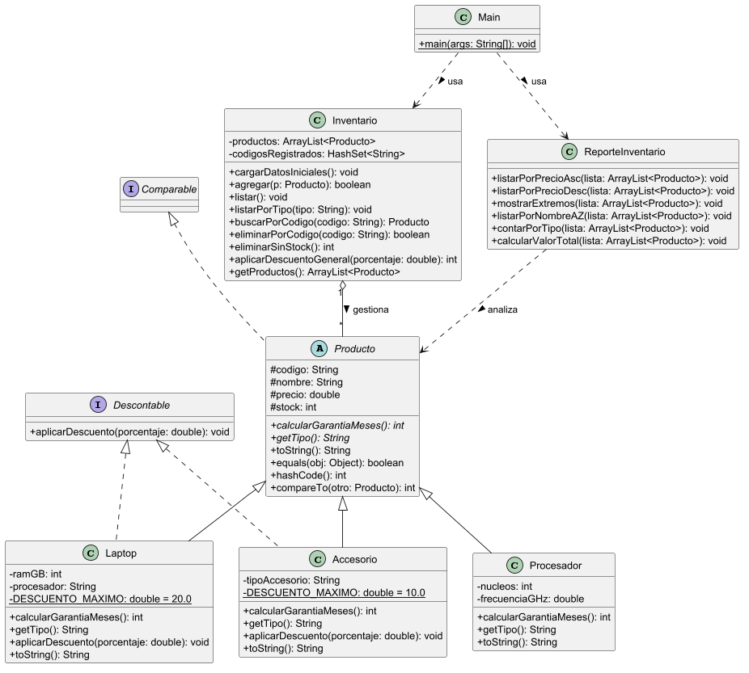

# PA4 - Jerarquía de productos y colecciones de objetos

## Descripción
Programa de consola en Java que gestiona el inventario de Computec con una
jerarquía de clases (clase abstracta e interface), colecciones de objetos
(ArrayList y HashSet) y operaciones de búsqueda, ordenamiento y eliminación.

## Integrantes
- [Sherlon Lisber Serrano Garcia] - Repositorio, clase abstracta Producto e interface Descontable
- [Alvaro Carita Huaman] - Subclases Laptop, Procesador y Accesorio
- [Yanire Dayana Alcantara Salinas] - Clase Inventario (colecciones)
- [Angelo Leonardo Fabrizio Cuadros Castillo] - Main y ReporteInventario
- [Ricardo Moisés Chauca Velazco] - Pruebas, README y diagrama

## Instrucciones de ejecución
1. Requiere JDK 21 e IntelliJ IDEA.
2. Clonar el repositorio y abrirlo como proyecto Maven.
3. Ejecutar la clase `Main` (paquete `pe.edu.isil`).

## Diseño adoptado

### Decisiones de diseño

* **¿Por qué herencia?**
  Se aplicó herencia mediante la superclase `Producto` y sus subclases `Laptop`, `Procesador` y `Accesorio` para centralizar los atributos comunes de todo artículo del inventario (`codigo`, `nombre`, `precio` y `stock`), así como la lógica compartida de validación, comparación e identificación (`equals`, `hashCode` y `compareTo`). Esto evita duplicar código (principio *DRY*), facilita el mantenimiento y permite gestionar todos los productos de forma uniforme mediante polimorfismo.

* **¿Por qué clase abstracta e interface?**
  * **Clase abstracta (`Producto`):** Se definió como abstracta porque en el inventario de Computec no existe un "producto genérico" instanciable, sino categorías físicas concretas. Además de compartir estado (atributos), obliga a cada subclase a sobrescribir los métodos abstractos `calcularGarantiaMeses()` y `getTipo()` según sus propias reglas de negocio.
  * **Interfaces (`Descontable` y `Comparable<Producto>`):** Se utilizó la interfaz `Descontable` para definir un contrato de comportamiento transversal que no depende de la jerarquía de herencia. Esto permite que solo las categorías elegibles (`Laptop` con un tope del 20% y `Accesorio` con un tope del 10%) apliquen descuentos sin forzar a `Procesador` a implementar dicha funcionalidad. Asimismo, `Comparable<Producto>` establece el orden natural por precio para facilitar los reportes.

* **¿Por qué `ArrayList` y `HashSet` juntos?**
  * **`ArrayList<Producto>`:** Se empleó como colección principal del catálogo en `Inventario` porque mantiene un orden dinámico, permite recorridos secuenciales completos y facilita las operaciones de ordenamiento (por precio ascendente, descendente o nombre) y generación de reportes.
  * **`HashSet<String>`:** Se utilizó de forma complementaria para almacenar exclusivamente los códigos únicos registrados (`codigosRegistrados`). Esto garantiza la integridad de los datos impidiendo el registro de productos duplicados y ofrece búsquedas de validación en tiempo constante (`O(1)` mediante `contains`), combinando la rapidez de verificación del `HashSet` con la flexibilidad de ordenamiento del `ArrayList`.

## Video de exposición
(Pegar el enlace de YouTube)
